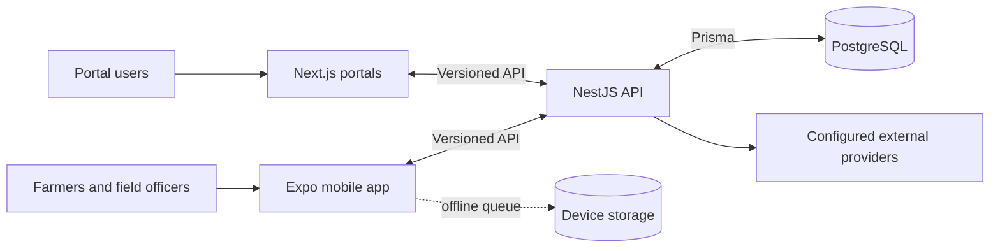
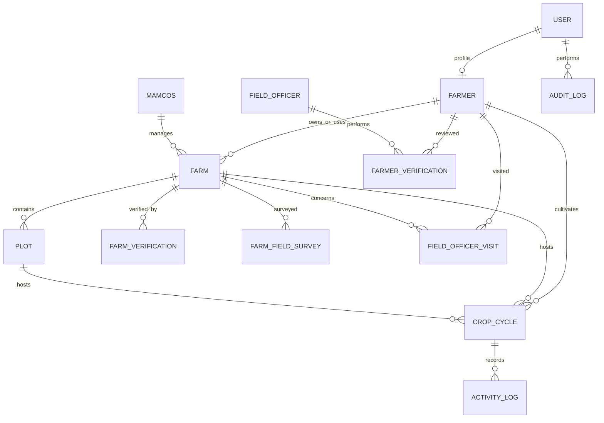
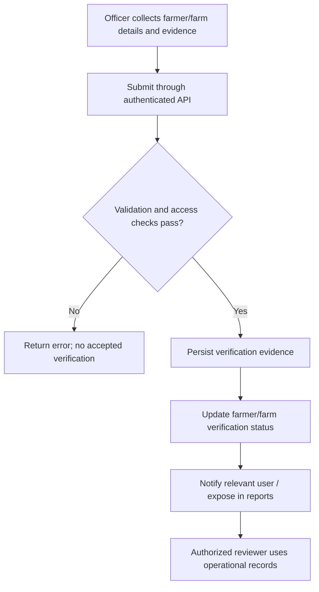

# MAYODE Software Documentation

**Prepared for:** System Owner  
**Prepared on:** 26 October 2026  
**Scope:** Source-based technical manual, architecture, data model overview, and field verification/MRV workflow notes.

## 1. Purpose and scope

MAYODE is an agricultural information and operations platform. This document summarizes the implementation visible in the source repository. It is intended as a technical handover aid, not as a production operations manual: hosting, release procedures, backup/restore, and incident response must be completed with the system operator.

The system has mobile clients, web portals, a NestJS API and PostgreSQL persistence. See the companion [System Architecture & Technical Design](mayode-system-architecture-owner-brief.md) for component-level diagrams and technology details.

## 2. Technical manual

### 2.1 Main components

- **Mobile:** React Native/Expo application used for farmer and field workflows. It captures forms, GPS, images and field observations. Selected field operations queue changes in local AsyncStorage and replay them when a connection is available.
- **Web:** Next.js portals for farmer, cooperative and administrator workflows.
- **API:** NestJS application, written in TypeScript, with feature modules/controllers/services. Routes are prefixed `/api/v1`. Swagger documentation is configured at `/api/docs`.
- **Persistence:** PostgreSQL accessed through Prisma. The canonical backend Prisma schema is `backend/prisma/schema.prisma`; schema changes are tracked in `backend/prisma/migrations/`.
- **External integrations:** Provider-backed services include SMS, payments (ClickPesa configuration), push notifications, WhatsApp and weather. Whether each is enabled in production depends on deployment secrets and provider accounts.

### 2.2 Request and data handling

1. A client sends an API request over HTTPS in the deployed environment.
2. Authentication guards and role/permission checks protect relevant controllers.
3. Global validation transforms and validates DTOs, removes no unknown input silently, and rejects non-whitelisted fields.
4. Feature services apply business rules and use Prisma to access PostgreSQL.
5. The API returns the result. Clients display the result; supported mobile writes remain queued until successful synchronization.

### 2.3 Local development (source-defined commands)

Backend commands are defined in `backend/package.json`: `npm install`, `npm run start:dev` for watch mode, and `npm run build` to compile. A PostgreSQL `DATABASE_URL` and required provider/auth settings must be supplied through a local environment configuration based on `backend/.env.example`. Do not put production secrets in source control or in the handover archive.

The mobile app defines `npm start` for Expo development. The web workspace defines its own development/build scripts in `web/package.json`. Version compatibility requirements are documented by each workspace's package manifests.

### 2.4 Security and roles

The API uses JWT authentication and role/permission guards. The data model supports user roles, cooperative associations, and audit records. Production CORS origins are configured with `CORS_ORIGINS`; the backend also adds browser security headers. Review actual deployment configuration, account lifecycle, secret rotation, and database backup access with the operator before production handover.

## 3. Architecture and data flow

The client/API/database relationship is described in more detail in the companion architecture brief. Field data can be captured in the app, held in its user-scoped queue while offline, and sent to the API once the connection is restored. The API persists accepted data and returns the saved state.

## 4. Database schema overview

The database is relational PostgreSQL. Prisma models, enums, relations and migrations define the application schema. This is a conceptual ER view of key field-data entities; MAYODE has many additional operational and finance entities not shown here.

| Data area | Main models/tables | Examples of stored information |
|---|---|---|
| Identity | `User`, `Farmer`, `MamcosStaff` | Contact/profile, roles, cooperative membership and verification status |
| Land | `Farm`, `Plot`, `FarmOwnership`, `FarmLease` | Area, location, boundaries, water source, tenure and plot data |
| Field evidence | `FarmVerification`, `FarmerVerification`, `FarmFieldSurvey`, `FieldOfficerVisit`, `FarmPhoto` | GPS evidence, survey data, water/soil/road characteristics, visit observations and media references |
| Production | `CropCycle`, `ActivityLog`, `Activity`, `HarvestRecord` | Seasons, crop stages, activities, inputs, labor and harvest records |
| Governance and traceability | `AuditLog`, consent and document records | Change history, consent and document metadata |

Farm and plot boundaries are represented in JSON fields in the Prisma schema. Although a schema comment mentions GeoJSON/PostGIS, the implementation stores coordinate data as JSON and says PostGIS is not required. Confirm coordinate conventions and area-calculation rules before using mapped areas for formal reporting.

## 5. Field verification and MRV workflow

### 5.1 What the current code implements

The source supports **operational identity and farm verification**. A field officer or authorized administrator submits verification evidence through a protected API endpoint. For a farm, the service checks that the officer has a field-officer profile, that the farm exists and is not already verified, then transactionally creates a `FarmVerification` record and marks the farm verified. Evidence fields include officer, timestamp, GPS-verified flag, neighboring references, cooperative approval, optional photo proof and notes.

Farmer verification records include status, officer, GPS/document review flags, coordinates, notes and rejection reason. The farmer workflow writes the verification record and updates the farmer's status together, then sends a user notification. Other workflows and reports consume these statuses.

### 5.2 MRV distinction and current gap

MRV usually means **measurement, reporting and verification** of quantified environmental outcomes under a defined methodology. The source reviewed contains farm/farmer verification, GPS, activity, input, water and production records, and reports. A search did not identify a carbon accounting/offset calculation service, emission-factor registry, methodology versioning, quantified greenhouse-gas result, or independent carbon-credit verification workflow.

Accordingly, the existing verification workflow should not be described as carbon MRV, a carbon-offset calculator, or certification of emissions reductions. The platform provides potentially relevant source data, but does not establish the calculations or independent assurance needed to claim carbon outcomes.

### 5.3 Recommended MRV design if required

Before implementation, the owner/program partner should select the applicable approved methodology and specify project boundary, baseline, monitoring period, eligible practices, source evidence, uncertainty treatment, leakage/permanence rules, data retention, validation/verification body and reporting format. A future MRV capability should:

1. Define required observations and evidence by activity and monitoring period.
2. Record source record IDs, timestamps, locations, responsible collectors, consent, and evidence references.
3. Store the methodology and emission-factor versions used for every calculation.
4. Keep raw observations immutable or auditable and make corrections traceable.
5. Produce reproducible calculations and review-ready reports with assumptions and uncertainty.
6. Route results to an authorized independent verifier and record decisions separately from field data collection.

No carbon result should be published until this methodology and workflow are implemented, reviewed, and validated by the program's qualified parties.

## 6. Source code handover

The companion `handover/mayode-source-code-handover.zip` contains a source-only snapshot of the core backend, mobile application, and web portals, plus package manifests, database schema/migrations, and this documentation. It intentionally excludes dependency directories, local environment files, uploads, build artifacts and Git history. A SHA-256 manifest beside the archive provides integrity checks. The archive is a snapshot, not a standalone runnable deployment; dependencies and environment-specific configuration must be provisioned separately.

For authorship evidence, preserve the original Git repository and its commit history. A checksum proves that a file matches the packaged copy; it does not by itself prove who authored the file or when.

## 7. Owner/operator completion checklist

- Confirm the official production architecture, provider accounts, deployed versions and service URLs.
- Document backup, restore testing, recovery objectives, monitoring, log retention and release/rollback steps.
- Confirm data ownership, consent, retention and access-review policy.
- Confirm whether a carbon MRV methodology is in scope and who will validate/verify it.
- Record the release commit SHA that corresponds to the delivered source archive.

## 8. Source references

Primary implementation references include `backend/src/main.ts`, `backend/src/farm-verifications/`, `backend/src/farmers/farmers.service.ts`, `backend/src/reports/`, `backend/prisma/schema.prisma`, `backend/prisma/migrations/`, `mobile/src/services/sync-queue.ts`, and the `mobile/`, `web/` package manifests.
