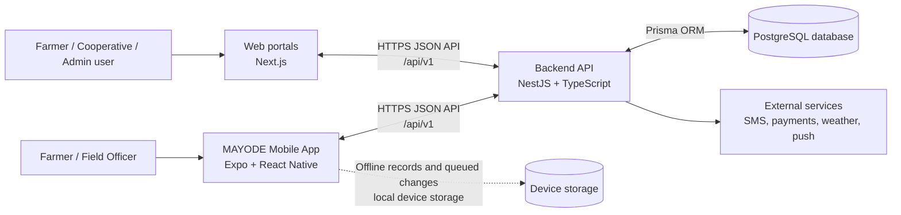
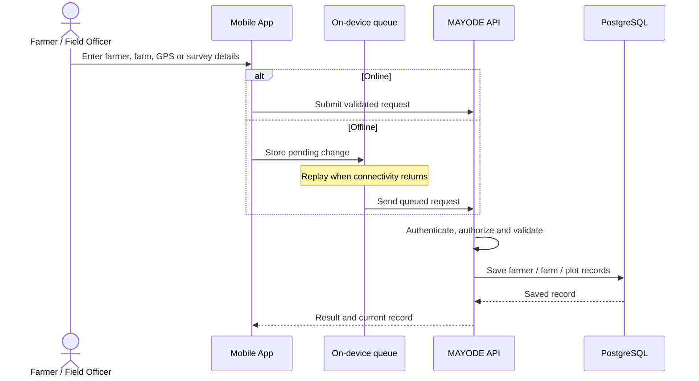

# MAYODE System Architecture & Technical Design

**Prepared for:** System Owner  
**Prepared on:** 26 October 2026  
**Purpose:** Describe the system architecture, technology stack, and field-data flows based on the current MAYODE source code.

## 1. Executive summary

MAYODE is an integrated agricultural platform with a mobile application for farmers and field teams, web portals for farmers, cooperatives and administrators, a backend API, and a PostgreSQL database. The mobile app can retain selected field changes on the device while offline and synchronize them with the backend when connectivity returns.

The backend provides the business rules and access control for farmer and farm records, field visits, crop activities, cooperative operations, payments, reports, notifications and related services. The database schema includes farmer, farm, plot, water-access, GPS and audit information.

This brief describes what is visible in the repository. The cloud hosting provider, production network layout, backup schedule, disaster-recovery arrangements, and any external carbon-accounting service are not established by the source reviewed and should be confirmed with the system owner or hosting administrator.

## 2. High-level architecture

The mobile application and web portals call the backend API. The API validates incoming data, applies business rules and authorization, and reads or writes records through Prisma to PostgreSQL. The API uses the `/api/v1` route prefix. In production, browser origins are restricted to the configured `CORS_ORIGINS` list.

Mobile field changes that support offline operation are queued on the device and replayed to the API after connectivity is restored. This is a store-and-forward flow; background execution depends on operating-system scheduling and is not guaranteed to run at an exact time.

The codebase includes integrations/configuration for SMS, ClickPesa payments, Expo push notifications, WhatsApp messaging and weather services. Availability in a live environment depends on production credentials and provider setup.

## 3. Technology stack

| Layer | Technology evidenced in repository | Role |
|---|---|---|
| Mobile app | React Native 0.86, Expo 57, TypeScript, Expo Router | Farmer and field-staff workflows, GPS capture, notifications, offline queue and synchronization |
| Web portals | Next.js 16, React 19, TypeScript (web workspace) | Farmer, cooperative and administrator browser interfaces |
| Public website | Next.js 16, React 19 | MAYODE public-facing website |
| Backend | Node.js, NestJS 11, TypeScript | Versioned API, validation, authentication, business services, reports and integrations |
| Database | PostgreSQL | Persistent application records and relationships |
| Data access | Prisma ORM 7 | Typed database access and schema/migration management |
| Device persistence | React Native AsyncStorage | Authentication state and queued offline changes on mobile |
| API documentation | Swagger / OpenAPI | Interactive API documentation exposed by the backend |
| Integrations | ClickPesa, SMS provider configuration, Expo notifications, WhatsApp, weather provider | Payments and communication/weather features where configured |

The PostgreSQL schema stores farm and plot boundary coordinates as JSON/GeoJSON-style data; the schema comments indicate that PostGIS is not required by the current implementation.

## 4. Data flow diagrams

### 4.1 Farmer registration and farm mapping

1. A farmer or field officer enters profile details and farm information in the mobile app or an authorized web portal.
2. The client submits the information to the API. For offline-capable mobile workflows, selected changes are stored in a per-user local queue until they can be sent.
3. The API validates request fields, checks the signed-in user's access, and applies the relevant farmer/farm service rules.
4. Prisma writes the resulting records to PostgreSQL. The schema includes farmer identity and location fields, farm GPS centre/boundary fields, plots, verification records and audit-related data.
5. The API returns the saved record or an error. On mobile, a queued change is removed after successful replay; a failed change remains available for retry and dependent queued changes wait behind it.

### 4.2 Water-management and field-visit records

1. A field officer records a visit or farm survey, including the applicable water-source, water-reliability, GPS and field-condition details.
2. The mobile app saves supported offline submissions locally or submits them directly to the API.
3. The API validates and associates the record with the authorized officer, farm or cooperative context.
4. The record is persisted in PostgreSQL and can be used by operational views and reports. The schema includes field-survey water fields and field-visit GPS/condition fields.

### 4.3 Processing and carbon-offset calculations

The repository contains agricultural, activity, production and reporting functionality, but a search of the backend and Prisma schema did not identify a carbon-offset/emissions calculation module or a documented calculation methodology. Therefore this flow cannot be presented as an existing, verified system capability.

If carbon accounting is required, the owner should confirm the methodology and source data, including applicable activity inputs, emission factors, calculation boundaries, review/verification rules and reporting requirements. A future implementation could ingest verified field and production records, apply an approved methodology in a dedicated calculation service, preserve factor/version and source-record references, and produce reviewable results. Until implemented and validated, carbon-offset figures should not be represented as calculated or certified by the current platform.

## 5. Security and data handling visible in code

- API requests pass through DTO validation; unknown fields are rejected by the global validation pipe.
- The backend defines bearer-token authentication support and role-based application modules. Access should be granted according to the user's role and cooperative scope.
- Production browser access is limited through configured CORS origins.
- The API sets several browser security headers and exposes API documentation through Swagger.
- Mobile offline data is held in local app storage and submitted after reconnection. Device-level protection, retention limits and remote wipe behavior should be reviewed against the owner's security requirements.
- The schema includes audit records and records for authentication/session-related data. Production secret handling and rotation should be confirmed from the deployment environment; example environment files are not production configuration.

## 6. Operational items for owner confirmation

To turn this source-based design into a complete production architecture record, confirm:

1. The production hosting provider, deployed environments, domains and network boundaries.
2. Database hosting, encryption, backup frequency, retention, restore testing and recovery targets.
3. Production API URL, TLS termination, monitoring, alerting and log retention.
4. Which SMS, payment, weather, WhatsApp and push providers are live, and who owns their credentials.
5. Personal-data retention, consent, access-review and incident-response procedures.
6. Whether carbon-offset calculations are an approved requirement; if so, the methodology, verifier and implementation plan.

## 7. Source references

This document was prepared from the repository's mobile, web, backend and Prisma schema/configuration files, including `mobile/package.json`, `mobile/src/services/sync-queue.ts`, `web/package.json`, `backend/package.json`, `backend/src/main.ts`, `backend/src/app.module.ts`, `backend/.env.example`, and `backend/prisma/schema.prisma`.

**Owner review:** Please confirm the production infrastructure and operational details above before treating this brief as the authoritative deployment/runbook record.
